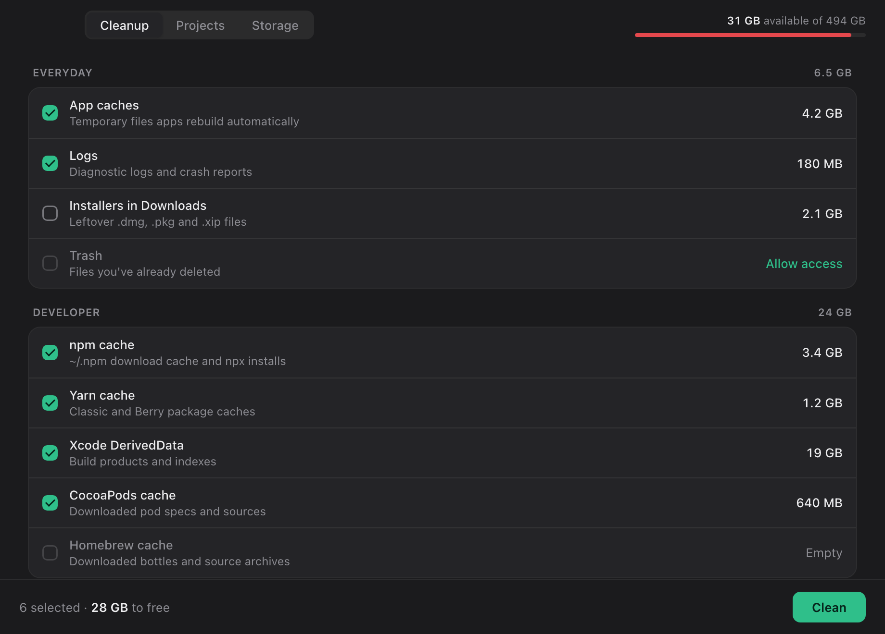
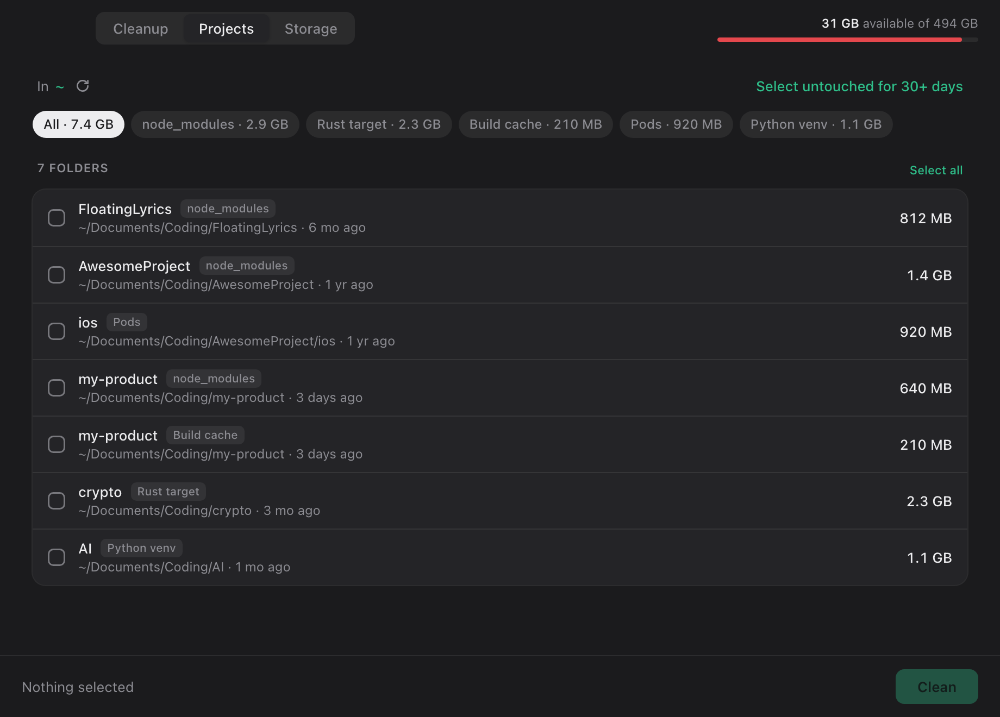
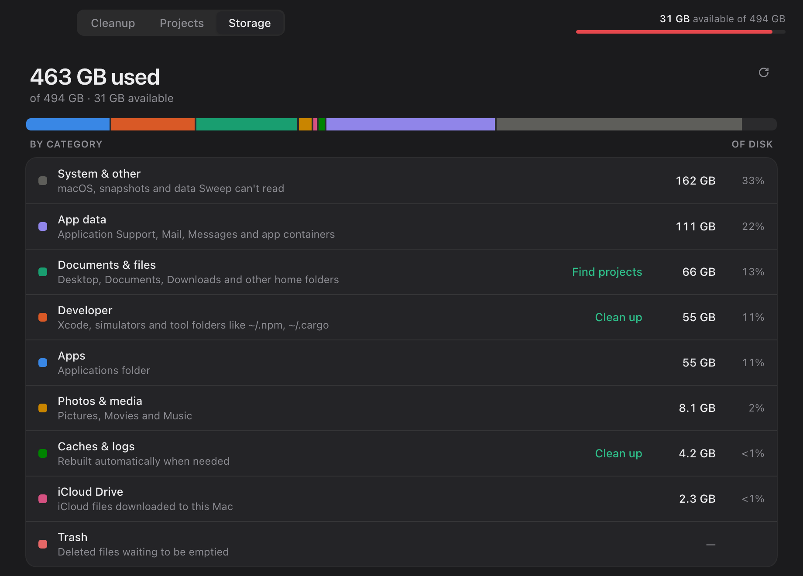

<p align="center">
  
</p>

<h1 align="center">Sweep</h1>

<p align="center">
  A fast, minimal disk cleaner for macOS: clear caches, developer tool leftovers and old project folders in a few clicks.
</p>

<p align="center">
  
</p>

---

## Contents

- [Features](#features)
- [Requirements](#requirements)
- [Install](#install)
  - [Homebrew (recommended)](#homebrew-recommended)
  - [Manual download](#manual-download)
  - ["Sweep can't be opened"](#sweep-cant-be-opened--apple-could-not-verify)
- [Usage](#usage)
  - [Cleanup](#cleanup)
  - [Projects](#projects)
  - [Storage](#storage)
  - [Cleaning the Trash (Full Disk Access)](#cleaning-the-trash-full-disk-access)
- [Safety](#safety)
- [Build from source](#build-from-source)
  - [Project layout](#project-layout)
- [License](#license)

## Features

- **Cleanup.** Frees app caches, logs, leftover installers in Downloads and the Trash, plus developer caches for npm, Yarn, pnpm, Bun, Xcode, Simulator, CocoaPods, Gradle, Cargo, pip, Go and Homebrew.
- **Projects.** Finds regenerable folders inside your projects, like `node_modules`, Rust `target`, `Pods` and Python virtualenvs, and picks out the ones you haven't touched in 30+ days.
- **Storage.** Shows what's using your disk by category, with links to the matching cleanup.
- **Fast and small.** A Rust core scans and deletes in parallel. The whole app is about 10 MB.
- **Safe by design.** It only deletes what its own scan found, inside your home folder, after you confirm.

<p align="center">
  
  &nbsp;
  
</p>

## Requirements

- A Mac with **Apple Silicon** (M1 or later)
- macOS 11 Big Sur or later

## Install

### Homebrew (recommended)

```bash
brew install --cask minhchienwikipedia/tap/sweep
```

To update later, run `brew upgrade --cask sweep`. Homebrew skips the "Apple could not verify…" warning for you.

### Manual download

1. Download the latest `Sweep-x.y.z.dmg` from the [Releases](../../releases) page.
2. Open the DMG and drag **Sweep** into **Applications**.
3. Open Sweep from Applications.

### "Sweep can't be opened" / "Apple could not verify…"

This only applies to the manual download. The app isn't signed with an Apple Developer ID, so macOS blocks it the first time. To allow it:

1. Try to open the app once and dismiss the warning.
2. Go to **System Settings → Privacy & Security** and scroll down.
3. Next to the message about Sweep, click **Open Anyway** and confirm.

Or run this once in Terminal:

```bash
xattr -dr com.apple.quarantine /Applications/Sweep.app
```

## Usage

Sweep has three tabs. Nothing is deleted until you click **Clean** and confirm. Deletes are permanent (they skip the Trash), because that's what actually frees the space.

### Cleanup

Check the categories you want to clear, then click **Clean**. Your choices are remembered between launches, and the footer shows live progress while it deletes.

- **Everyday:** app caches, logs, leftover installers in Downloads, Trash
- **Developer:** npm, Yarn, pnpm, Bun, Xcode DerivedData and device support, Simulator caches, CocoaPods, Gradle, Cargo, pip, Go, Homebrew. Tools you don't have installed are hidden.

### Projects

Finds regenerable folders inside your projects. A folder is only listed when it sits next to the file that proves what it is:

| Kind | Folder | Only when next to |
|---|---|---|
| node_modules | `node_modules` | `package.json` |
| Build cache | `.next` `.nuxt` `.svelte-kit` `.turbo` `.parcel-cache` `.angular` `.expo` | `package.json` |
| Rust target | `target` | `Cargo.toml` |
| Pods | `Pods` | `Podfile` |
| Python venv | `.venv` `venv` `env` | contains `pyvenv.cfg` |
| Gradle | `build` `.gradle` | `build.gradle(.kts)` / `settings.gradle(.kts)` |
| Flutter | `build` `.dart_tool` | `pubspec.yaml` |

Projects are searched in your home folder by default. Click the folder next to **In** to search somewhere else.

Each row shows when the project was last touched. **Select untouched for 30+ days** picks the stale ones. You can reinstall or rebuild any of these folders later.

### Storage

Shows what's using your disk: Apps, Developer, Documents & files, Photos & media, iCloud Drive, Caches & logs, App data and Trash, plus **System & other** for the rest of the used space. Hover the bar for details, and use the links to jump to the matching cleanup.

Every folder counts toward exactly one category. Third-party cloud drives (`~/Library/CloudStorage`) are skipped, because listing them goes over the network. Without Full Disk Access, app containers are skipped too, to avoid macOS privacy prompts.

### Cleaning the Trash (Full Disk Access)

macOS only lets apps with **Full Disk Access** empty the Trash. Click **Allow access** next to Trash in the Cleanup tab. It opens **System Settings → Privacy & Security → Full Disk Access**, where you turn on Sweep. You may need to reopen Sweep afterwards.

The first time Sweep scans Desktop, Documents or Downloads, macOS asks for permission. Click **Allow** so it can find project folders and leftover installers there.

## Safety

- Hidden folders, `~/Library` and app bundles are never searched for projects, so global npm installs and editor extensions aren't touched.
- The backend only deletes paths it found in its own last scan. Every path must also be inside your home folder (or on `/Volumes`). Paths sent from the UI are never trusted.
- Every delete asks for confirmation first.
- Sizes are allocated disk blocks, and hard links are counted once, so pnpm stores aren't double-counted.

## Build from source

You need Rust (`curl https://sh.rustup.rs -sSf | sh`) and the Xcode Command Line Tools.

```bash
git clone https://github.com/minhchienwikipedia/sweep.git
```

```bash
cd sweep
```

Build the app into `dist/Sweep.app`:

```bash
./scripts/bundle.sh
```

Build the app and the installer DMG into `dist/Sweep-<version>.dmg`:

```bash
./scripts/make-dmg.sh
```

The first DMG build may ask to let Terminal control **Finder**. It uses that to lay out the installer window.

- **Dev run:** `cd src-tauri && cargo run`
- **Tests:** `cargo test`
- **Benchmark** a read-only scan of your home folder: `cargo test --release -- --ignored --nocapture`
- **UI preview** in a normal browser with fake data: serve `ui/` with any static server, and `dev-mock.js` stands in for the backend.

To publish a new version, bump `version` in `src-tauri/Cargo.toml`, then run `./scripts/release.sh`. It builds the DMG, creates the GitHub release and updates the Homebrew tap.

### Project layout

```
src-tauri/src/
  main.rs      Tauri commands + scan registry
  targets.rs   cache locations (everyday + developer)
  projects.rs  parallel project-artifact finder
  size.rs      parallel disk-usage calculation
  clean.rs     parallel deletion + safety checks
  disk.rs      free/total space (statfs)
  storage.rs   "what's using my disk" categories
  ticker.rs    live progress updates while scanning and deleting
ui/            index.html, style.css, app.js (dev-mock.js for browser preview)
scripts/       bundle.sh, make-icon.sh, make-dmg.sh, release.sh
homebrew/      Homebrew cask (copied to the tap on release)
images/        README screenshots
```

## License

[MIT](LICENSE)
